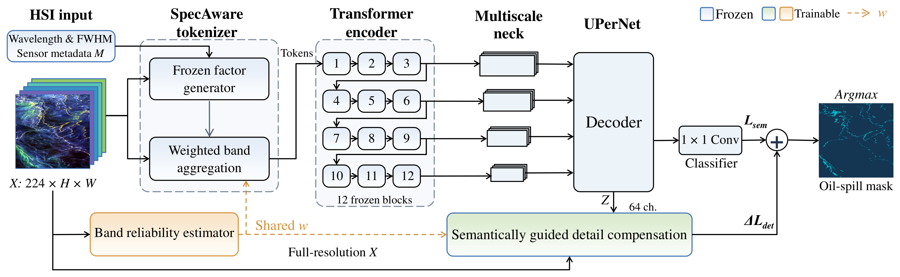
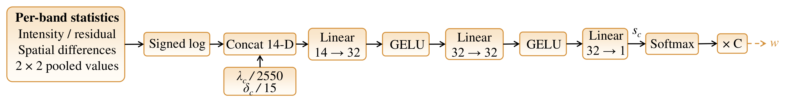
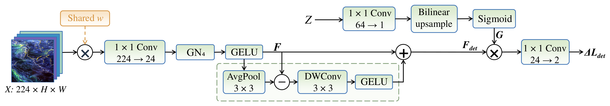

# SRPA-Net

PyTorch implementation of **SRPA-Net** (*Spectral Reliability-Guided Pretrained Adaptation Network for Hyperspectral Oil Spill Segmentation*), built upon a frozen pretrained SpecAware backbone with a band reliability estimator and a semantically guided detail compensation branch.

## Architecture

<p align="center">
  
</p>
<p align="center">
  <em>(a) Overall architecture of SRPA-Net.</em>
</p>

<p align="center">
  
</p>
<p align="center">
  <em>(b) Band reliability estimator.</em>
</p>

<p align="center">
  
</p>
<p align="center">
  <em>(c) Semantically guided detail compensation branch.</em>
</p>

## 1. Repository Structure

```text
SRPA-Net/
├── train.py                                # Main training, validation, and test script
├── run_experiments.py                      # Experiment preparation and sequential runner
├── infer_scene.py                          # Full-scene hyperspectral tiling inference and stitching
├── assets/
│   ├── overall_architecture.png            # Overall architecture diagram
│   ├── band_reliability_estimator.png      # Band reliability estimator diagram
│   └── detail_compensation.png             # Semantically guided detail compensation diagram
├── configs/
│   ├── selected_spectral_detail.json       # Main experiment config (Global Spectral Reliability + Spectral Detail)
│   ├── sensor_metadata_224.json            # 224-band center wavelengths, FWHM, and sensor metadata
│   └── text_embeddings.pt                  # Pre-cached SpecAware attribute text embeddings
├── environment/
│   ├── environment.yml                     # Conda environment specification
│   └── requirements.txt                    # Python package requirements
├── scripts/
│   └── train_selected.sh                   # Convenience launch script for the main experiment
├── src/
│   ├── __init__.py
│   ├── model.py                            # SRPANet base class, spectral reliability estimator, and SpecAware wrapper
│   ├── innovations.py                      # Spectral detail compensation branch (SpectralDetail) and full model
│   ├── data.py                             # 224-band oil spill tile dataset loader and metadata utilities
│   ├── runtime.py                          # GhostBatchNorm, mixed-precision fallback, and fused optimizer controls
│   └── experiment_controls.py              # Training schedules, loss functions, and optimizer parameter grouping
└── vendor/
    ├── SpecAware_README.md                 # Upstream SpecAware documentation
    ├── specaware/                          # Pretrained SpecAware encoder and UPerNet decoder
    └── benchmark/                          # Dataset cache reader and spatial augmentation utilities
```

## 2. Environment Setup

The code has been verified in the following environment (an NVIDIA GPU with CUDA support is required):

| Dependency | Version |
| :--- | :--- |
| Python | `3.11.11` |
| PyTorch / TorchVision | `2.5.1` / `0.20.1` (CUDA) |
| torchdata | `0.11.0` |
| timm | `1.0.15` |
| transformers / sentence-transformers | `4.51.3` / `4.1.0` |
| kornia | `0.8.0` |
| GDAL / NumPy | `3.6.2` / `< 2.0` |

### Option 1: Create via `environment.yml` (Recommended)

```bash
conda env create -f environment/environment.yml
conda activate SpecAware
```

### Option 2: Manual Conda + Pip Installation

```bash
conda create -n SpecAware python=3.11.11 -y
conda activate SpecAware

# Install geospatial and scientific dependencies (GDAL 3.6.2 requires the NumPy 1.x ABI)
conda install -y gdal=3.6.2 "numpy<2" rasterio netcdf4 pandas scipy

# Install PyTorch (adjust the CUDA index URL to match your local CUDA version; CUDA 12.1 example below)
pip install torch==2.5.1 torchvision==0.20.1 --index-url https://download.pytorch.org/whl/cu121

# Install remaining Python packages
pip install -r environment/requirements.txt
```

## 3. Pretrained Weights & Data Preparation

### 3.1 Download Pretrained SpecAware Weights

Download `SpecAware_Base_model.pth` from the [official SpecAware link](https://r2-proxy.3sobs.top/f6UhnB) (see [vendor/SpecAware_README.md](vendor/SpecAware_README.md)) and place it at:

```text
SRPA-Net/
└── checkpoints/
    └── SpecAware_Base_model.pth
```

### 3.2 Prepare the HOSD 224-Band Tile Dataset Cache

Prepare the preprocessed 224-band hyperspectral oil spill tiles (`.npy` format, per-tile per-band min–max normalized) under `data/224_fullbands/`:

- **Train (262 tiles)**: `GM02`, `GM05`–`GM08`, `GM10`–`GM14`, `GM16`, `GM17`
- **Validation (64 tiles)**: `GM03`, `GM15`, `GM18`
- **Test (76 tiles)**: `GM01`, `GM04`, `GM09`

```text
SRPA-Net/
└── data/
    └── 224_fullbands/
        ├── tr_images.npy       # shape: (262, 224, 224, 224), float32
        ├── tr_labels.npy       # shape: (262, 224, 224), uint8 (0=background, 1=oil, 255=ignore)
        ├── val_images.npy      # shape: (64, 224, 224, 224), float32
        ├── val_labels.npy      # shape: (64, 224, 224), uint8
        ├── ts_images.npy       # shape: (76, 224, 224, 224), float32
        └── ts_labels.npy       # shape: (76, 224, 224), uint8
```

> To use custom paths, update `pretrained_checkpoint`, `cache_root`, and `scenes_root` in `configs/selected_spectral_detail.json`.

## 4. Reproducing the Main Experiment

SRPA-Net freezes the pretrained SpecAware encoder and trains the band reliability estimator, the semantically guided detail compensation branch, and the UPerNet neck/decoder/head for 20,000 updates using AdamW (`lr=1e-4`, `betas=(0.9, 0.95)`, `weight_decay=1e-4`, effective batch size 8, seed 42), validating every 500 updates and selecting the best checkpoint by validation mIoU.

### Training and Evaluation

```bash
conda activate SpecAware
python run_experiments.py \
  --config configs/selected_spectral_detail.json \
  --run-dir runs/srpa_net
```

Or use the launch script:

```bash
bash scripts/train_selected.sh runs/srpa_net
```

- **Resuming**: If training is interrupted, re-running the same command with the same `--run-dir` automatically resumes from `last.ckpt` with model, optimizer, AMP scaler, and RNG states preserved.
- **Tile-only evaluation**: Pass `--skip-scene-predictions` if full `.mat` test scenes are not placed under `data/scenes/`.

### Outputs

After training and testing complete, outputs are saved to `runs/srpa_net/models/spectral_detail/`:

- `best.ckpt`: Best checkpoint selected by validation mIoU
- `last.ckpt`: Latest resumable checkpoint (model, optimizer, scaler, and RNG states)
- `result.json`: Full test metrics for both best-validation and final checkpoints
- `PR_mIoU_IoU_percent.csv`: Summary table of Precision, Recall, F1, Oil IoU, and mIoU (%)

## 5. Full-Scene Hyperspectral Inference

`infer_scene.py` supports `.mat` (default key `img`, shape `H×W×C`), `.npy` (shape `C×H×W`), and GDAL raster files. Scenes are tiled into non-overlapping `224×224` patches with edge padding, inferred, and stitched back to original dimensions:

```bash
python infer_scene.py \
  --run-dir runs/srpa_net \
  --variant spectral_detail \
  --scene /path/to/scene.mat \
  --output outputs/prediction \
  --threshold 0.5
```

Inference outputs:

- `outputs/prediction.probability.npy`: Oil probability map (`float32`, `H×W`)
- `outputs/prediction.mask.npy`: Binary segmentation mask (`uint8`, `H×W`)
- `outputs/prediction.tiles.jsonl`: Per-tile spectral reliability weight diagnostics
- `outputs/prediction.metadata.json`: Inference settings and scene metadata

## 6. Acknowledgements

The backbone encoder and decoder are built upon [SpecAware](https://www.sciencedirect.com/science/article/pii/S0924271626000754), and evaluations are conducted on the HOSD dataset (Duan et al., *IEEE TGRS*, 2023). We thank the authors for making their pretrained weights, code, and dataset publicly available.
